# Medicina y Salud

## Descripción
Mockup de la aplicación/sitio web "Medicina y Salud", diseñado en Figma. 
El proyecto contempla 12 secciones que representan las distintas pantallas 
y funcionalidades propuestas para ver y saber mas sobre la salud y medicina donde podras ver comidas saludables, bienestar, actividad fisica y muchas cosas mas.
## 🔗 Enlace a Figma
https://www.figma.com/make/e0wqjoBCll3O7KisvRJua5/Dise%C3%B1ar-sitio-web-MedSalud?t=GU9He07pPcHwmVDY-1

## 📸 Capturas de las secciones
Las imágenes de las 12 secciones del mockup se encuentran en la carpeta `capturas/` de este repositorio.

1. Inicio
2. Medicina
3. Emfermedades
4. Sintomas
5. Prevencion
6. Alimentacion saludable
7. Salud mental
8. Actividad fisica
9. Primeros auxilios
10. Medicamentos
11. Consejos
12. Contacto
...
## Instrucciones de instalación y ejecución local

1. Instalar [XAMPP](https://www.apachefriends.org) (o Laragon) e iniciar el servicio Apache.
2. Clonar este repositorio dentro de la carpeta `htdocs` de XAMPP:
```bash
   cd C:\xampp\htdocs
   git clone https://github.com/daniicamacho27/Medicina_y_salud.git medicina-salud
```
3. Copiar `config/env.example.php` como `config/env.php` y completar los valores:
```bash
   cd medicina-salud/config
   copy env.example.php env.php
```
4. Abrir el navegador en: http://localhost/medicina-salud/index.php 


## Evidencia de funcionamiento

### Servidor local ejecutándose
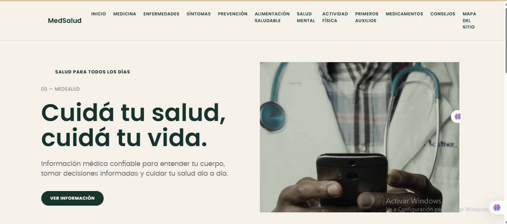

### Estructura modular (SSI)
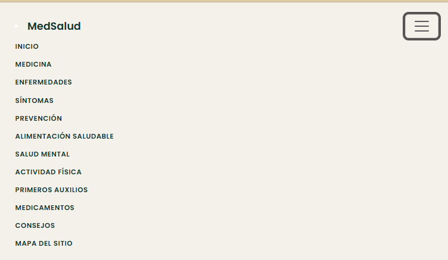
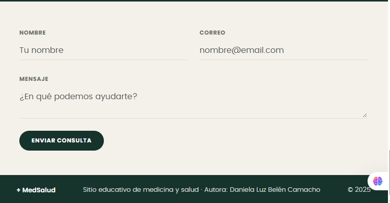

### Navegación dinámica
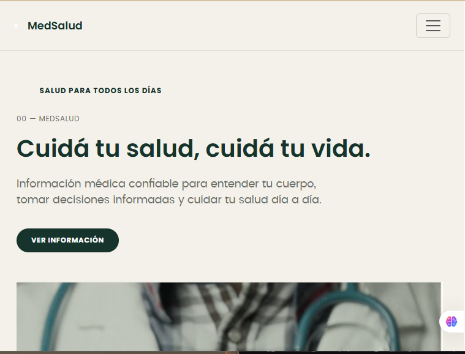
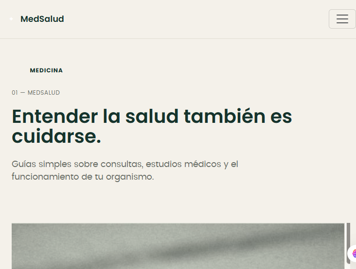
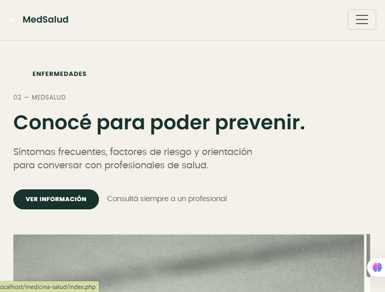

### Configuración de variables de entorno
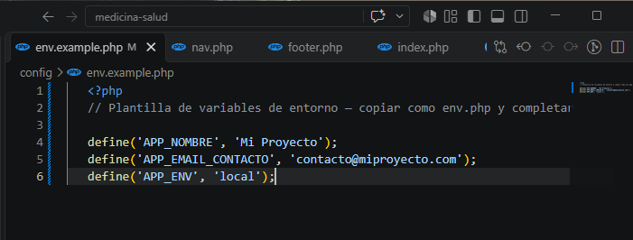

## Autora

Daniela Luz Belén Camacho


## Materia / Proyecto
Programacion Web
Medicina y Salud

## Clase 5 — Procesamiento de Formularios y Seguridad Web

Todo el desarrollo de esta entrega está en la carpeta [`clase5/`](clase5/).

### Formulario POST — Contacto (`clase5/contacto.php`)
Recibe `nombre`, `correo` y `mensaje` por **POST**. También se puede enviar desde el formulario de la página de inicio (`index.php`), que apunta a este mismo archivo.

- **Sanitización:** `filter_input(INPUT_POST, ...)` + `trim()`; toda salida se escapa con `e()` (`htmlspecialchars` con `ENT_QUOTES` y `UTF-8`) para evitar XSS.
- **Validación en servidor:** campos obligatorios; nombre de 2 a 60 caracteres; correo con `filter_var(FILTER_VALIDATE_EMAIL)`; mensaje de al menos 10 caracteres.
- **Mensajes:** alerta verde si el envío es correcto; alerta roja con la lista de errores y mensaje debajo de cada campo (`is-invalid` de Bootstrap).
- **Persistencia:** si hay errores, los campos conservan lo que se escribió.

### Formulario GET — Buscador (`clase5/buscar.php`)
Recibe el parámetro `q` por **GET** (ej: `buscar.php?q=salud`) y busca en las secciones del sitio con `mb_stripos`.

- **Sanitización:** `filter_input(INPUT_GET, ...)` + `trim()` y escape con `e()`.
- **Validación:** término no vacío y de al menos 2 caracteres.
- **Mensajes:** resultados encontrados, "sin resultados" o error de validación. El término se conserva en el campo.

### Archivos
| Archivo | Función |
|---|---|
| `clase5/funciones.php` | Función `e()` para escapar la salida |
| `clase5/contacto.php` | Formulario POST |
| `clase5/buscar.php` | Formulario GET |

### Capturas

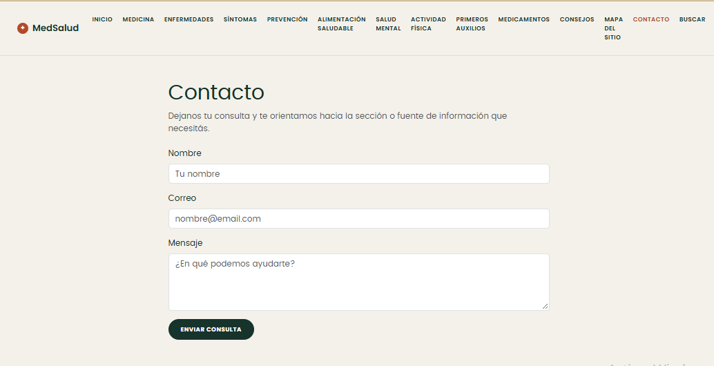

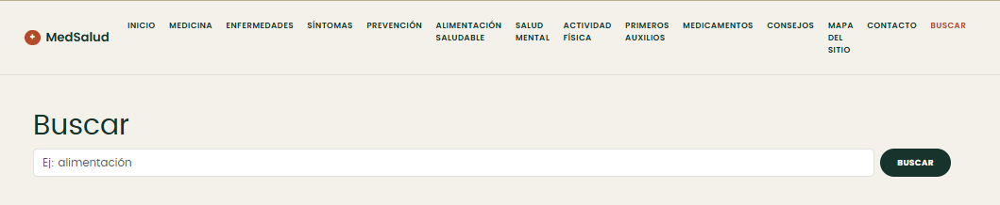


## TP N° 6 — Esquema relacional en MySQL

Los archivos están en la carpeta [`tp6/`](tp6/):

- [`NORMALIZACION.md`](tp6/NORMALIZACION.md): normalización (1FN, 2FN, 3FN) y listado de tablas.
- [`schema.sql`](tp6/schema.sql): crea la base `medsalud` con sus tablas, claves e índices.
- [`consultas.sql`](tp6/consultas.sql): pruebas CRUD (INSERT, SELECT con JOIN, UPDATE, DELETE).

### Cómo probarlo en XAMPP
Con MySQL iniciado en el panel de XAMPP, desde la carpeta del proyecto:

```powershell
C:\xampp\mysql\bin\mysql.exe -u root --default-character-set=utf8mb4 -e "source tp6/schema.sql"
C:\xampp\mysql\bin\mysql.exe -u root --default-character-set=utf8mb4 -t -e "source tp6/consultas.sql"
```

También se pueden importar desde phpMyAdmin: primero `schema.sql` y después `consultas.sql`.

### Evidencia de funcionamiento

## Tablas
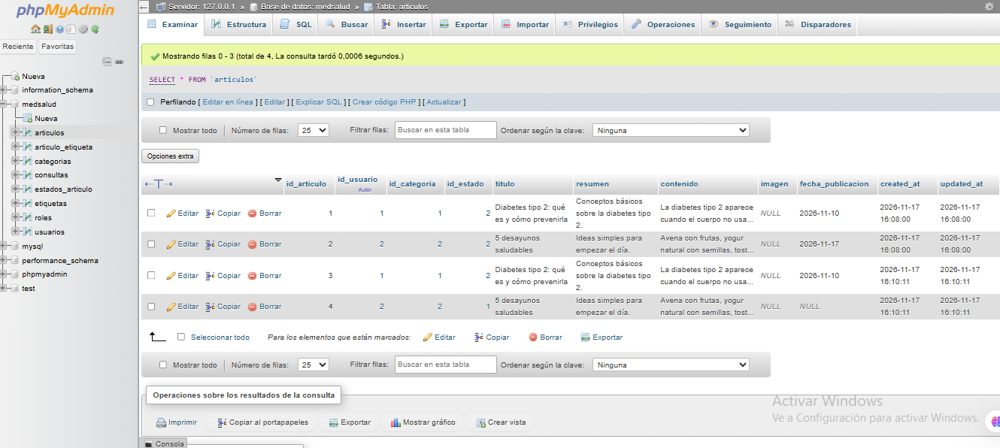

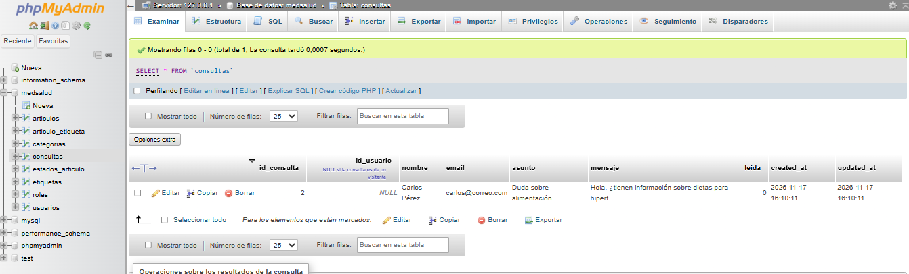

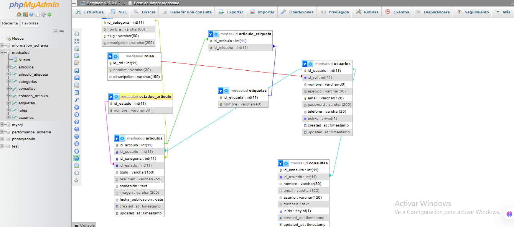


## TP N° 7 — Persistencia y conexión PHP-MySQL segura

Módulo CRUD de artículos integrado al sitio. Se accede desde el enlace **Administración** del footer o en `http://localhost/medicina-salud/admin/index.php`.

| Archivo | Función |
|---|---|
| `config/conexion.php` | Conexión PDO con `try-catch (PDOException)` |
| `admin/index.php` | Listado con INNER JOIN (Read) |
| `admin/crear.php` | Formulario e inserción (Create) |
| `admin/editar.php` | Formulario y actualización (Update) |
| `admin/eliminar.php` | Baja de registros por POST (Delete) |
| `admin/_datos.php`, `admin/_form.php` | Validación y formulario compartidos |

### Seguridad aplicada
- **Consultas preparadas** con `:parametros` en todas las operaciones (PDO, `EMULATE_PREPARES` desactivado).
- **Protección XSS:** toda salida se escapa con `e()` (`htmlspecialchars`).
- **Validación en el servidor** de campos y de las claves foráneas (autor, categoría y estado).
- La baja se hace por **POST** con confirmación, no por un enlace GET.

### Evidencia de funcionamiento
**Listado de artículos**
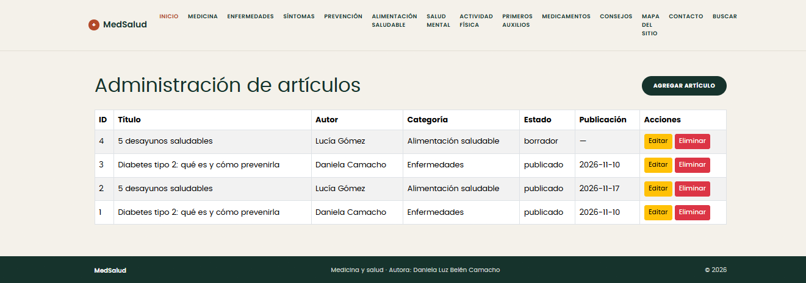

**Alta con validación**
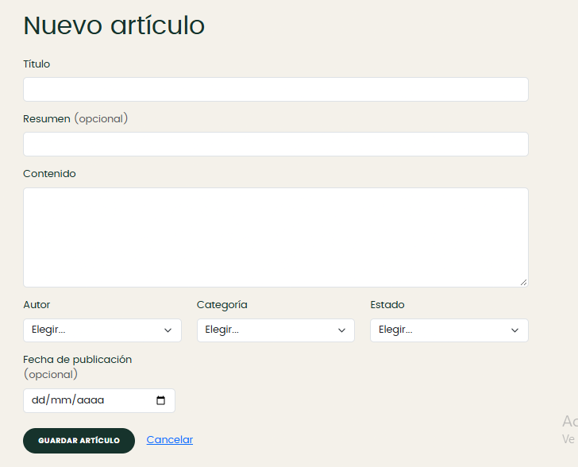

**Edición**
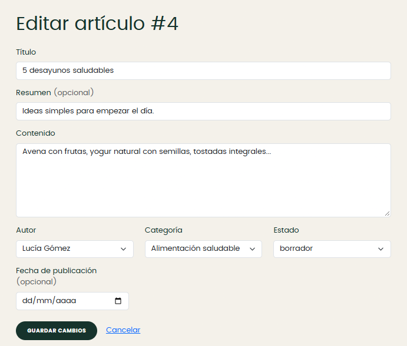

**Mensaje de éxito**
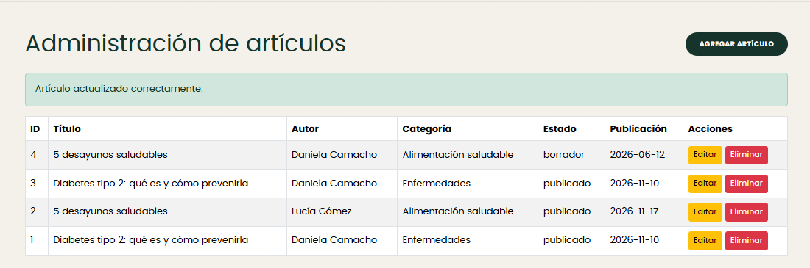

**Datos en phpMyAdmin**
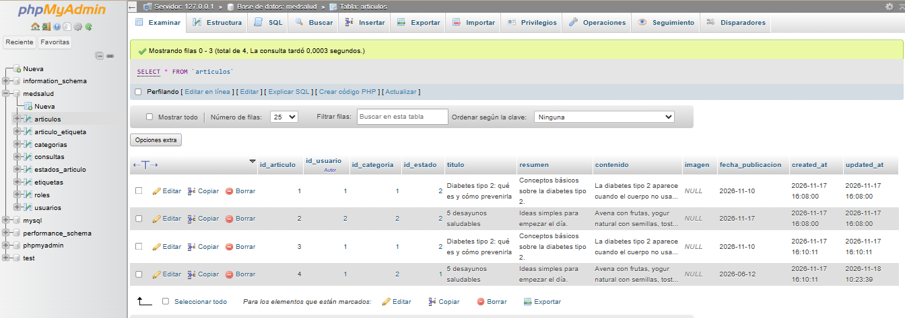

**Eliminación con confirmación**
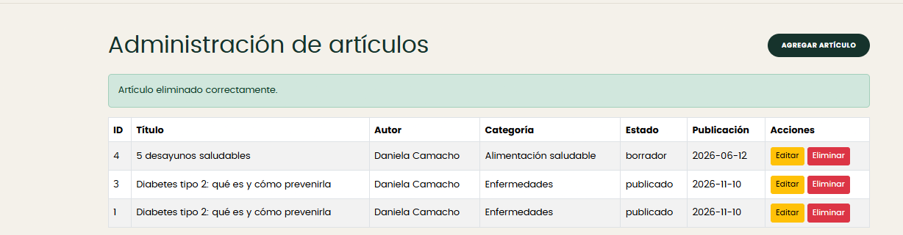

## TP N° 8 — Manejo de estado, sesiones y autenticación

Módulo de registro, inicio y cierre de sesión con sesiones PHP, conectado a MySQL, con protección de rutas y control de acceso por roles.


### Archivos

| Archivo | Función |
|---|---|
| `registro.php` | Alta de usuarios con validación y contraseña hasheada |
| `login.php` | Validación de credenciales y creación de la sesión |
| `logout.php` | Cierre de sesión y borrado de la cookie |
| `dashboard.php` | Vista protegida para cualquier usuario autenticado |
| `admin_panel.php` | Vista protegida solo para el rol `admin` |
| `includes/sesion.php` | Inicio de sesión con cookie segura |
| `includes/auth_guard.php` | Guardián de rutas y función `exigir_rol()` |
| `admin/_guard.php` | Protege el CRUD de artículos del TP7 (solo `admin`) |
| `tp8/auth.sql` | Agrega el rol `usuario` a la tabla `roles` |

### Flujo de autenticación

1. **Registro:** se validan los datos, se verifica que el email no exista y se guarda el hash de la contraseña con rol `usuario`.
2. **Login:** se busca al usuario por email, se compara con `password_verify()`, se regenera el ID de sesión y se guardan `usuario_id`, `usuario_nombre` y `rol` en `$_SESSION`.
3. **Guardián (`auth_guard.php`):** si no existe `$_SESSION['usuario_id']`, redirige a `login.php?error=acceso_denegado`. Con `exigir_rol('admin')` responde **403** si el rol no coincide.
4. **Logout:** vacía la sesión, elimina la cookie `PHPSESSID` y destruye la sesión.


### Seguridad aplicada

- Contraseñas con `password_hash($password, PASSWORD_BCRYPT)` y verificación con `password_verify()` (nunca se guarda texto plano).
- Consultas preparadas con PDO en todo el módulo (previene inyección SQL).
- Validación de entradas en el servidor y salida escapada con `htmlspecialchars` (previene XSS).
- `session_regenerate_id(true)` al iniciar sesión (previene *session fixation*).
- Cookie de sesión con `HttpOnly` y `SameSite=Lax`. La marca `Secure` se activa automáticamente cuando el sitio se sirve por HTTPS (en `localhost` con HTTP queda desactivada).
- Mensaje de error genérico en el login (no revela si el email existe).
- Límite de 72 caracteres en la contraseña, que es lo que procesa bcrypt.
- Control de acceso por rol en el servidor, no solo ocultando enlaces del menú.

### Evidencia de funcionamiento

**Acceso denegado sin sesión (redirección a `login.php?error=acceso_denegado`)**
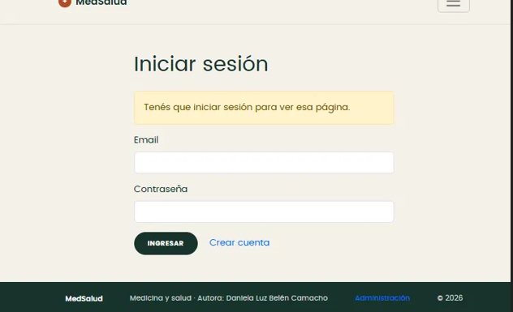


**Registro con validación (email duplicado)**
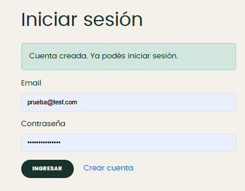


**Contraseña hasheada en phpMyAdmin**
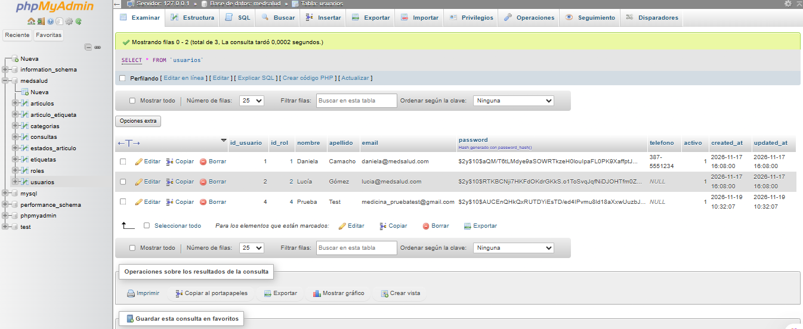


**Dashboard de un usuario autenticado**
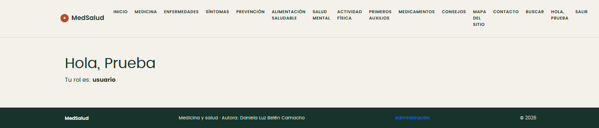


**Error 403 para un usuario sin rol admin**
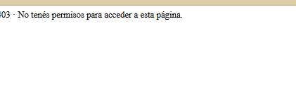


**Panel de administración (rol admin)**
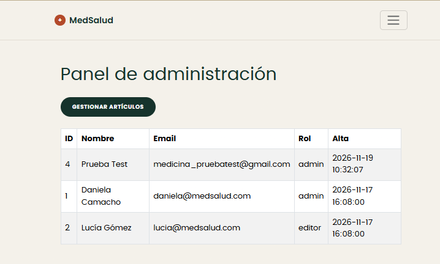


**Cookie de sesión antes y después del login (el ID cambia y es HttpOnly)**
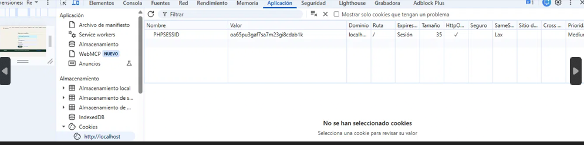


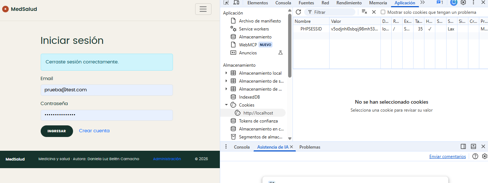

**Cierre de sesión**

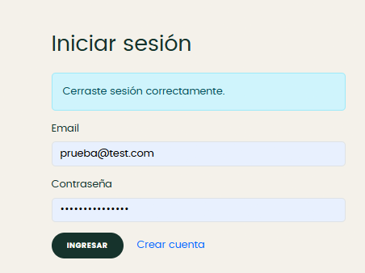

