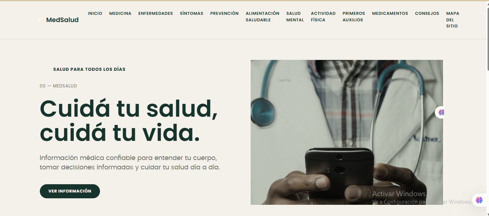
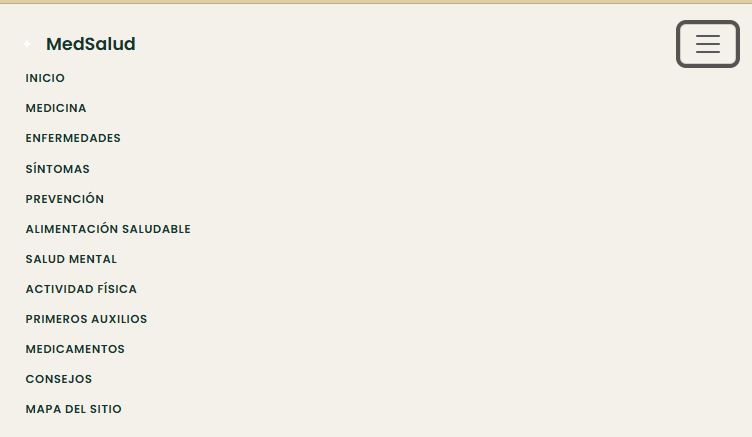
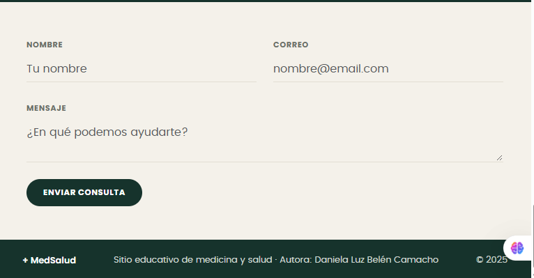
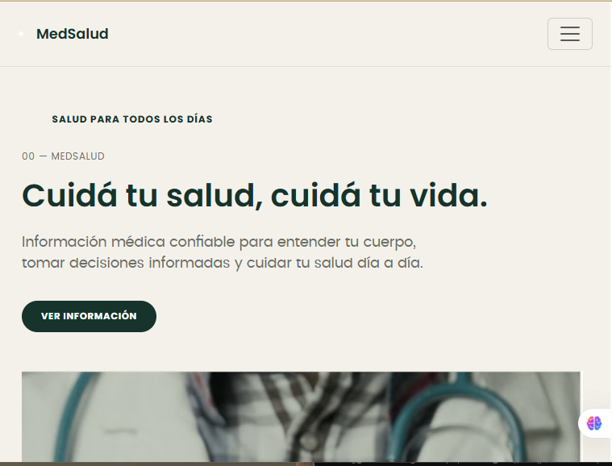
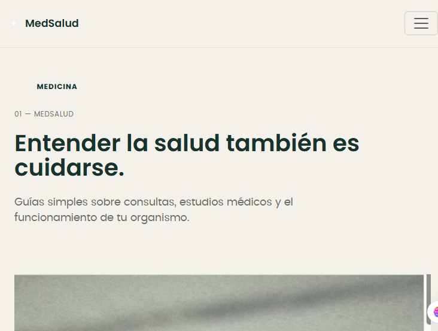
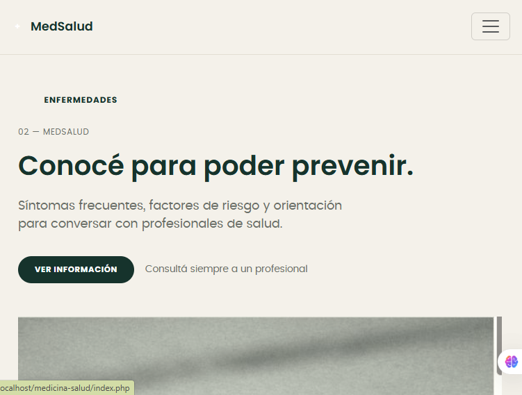
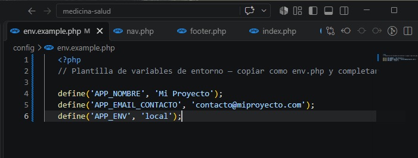

# Medicina y Salud

## Descripción
Mockup de la aplicación/sitio web "Medicina y Salud", diseñado en Figma. 
El proyecto contempla 12 secciones que representan las distintas pantallas 
y funcionalidades propuestas para ver y saber mas sobre la salud y medicina donde podras ver comidas saludables, bienestar, actividad fisica y muchas cosas mas.
## 🔗 Enlace a Figma
https://www.figma.com/make/e0wqjoBCll3O7KisvRJua5/Dise%C3%B1ar-sitio-web-MedSalud?t=GU9He07pPcHwmVDY-1

## 📸 Capturas de las secciones
Las imágenes de las 12 secciones del mockup se encuentran en la carpeta `capturas/` de este repositorio.

1. Inicio
2. Medicina
3. Emfermedades
4. Sintomas
5. Prevencion
6. Alimentacion saludable
7. Salud mental
8. Actividad fisica
9. Primeros auxilios
10. Medicamentos
11. Consejos
12. Contacto
...
## Instrucciones de instalación y ejecución local

1. Instalar [XAMPP](https://www.apachefriends.org) (o Laragon) e iniciar el servicio Apache.
2. Clonar este repositorio dentro de la carpeta `htdocs` de XAMPP:
```bash
   cd C:\xampp\htdocs
   git clone https://github.com/daniicamacho27/Medicina_y_salud.git medicina-salud
```
3. Copiar `config/env.example.php` como `config/env.php` y completar los valores:
```bash
   cd medicina-salud/config
   copy env.example.php env.php
```
4. Abrir el navegador en: http://localhost/medicina-salud/index.php 


## Evidencia de funcionamiento

### Servidor local ejecutándose


### Estructura modular (SSI)



### Navegación dinámica




### Configuración de variables de entorno


## Autora

Daniela Luz Belén Camacho

## Autor/es
Daniela Luz Belén Camacho

## Materia / Proyecto
Programacion Web
Medicina y Salud
